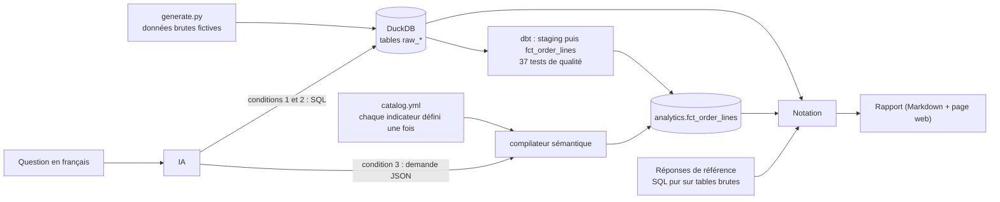

# Analyste IA fiable

**Peut-on faire confiance à une IA pour répondre aux questions chiffrées d'une entreprise ?**
Ce projet le mesure, au lieu de le supposer.

Un dirigeant pose une question en français (« quel est mon chiffre d'affaires par région ? ») et une IA répond. Le risque n'est pas que l'IA échoue : c'est qu'elle livre **un chiffre faux avec aplomb**. Ce dépôt construit un banc d'essai de 60 questions métier, avec réponses de référence, et compare trois façons de brancher l'IA sur les données :

| Condition | Ce que l'IA reçoit | Qui écrit le SQL ? |
|---|---|---|
| **1. Tables brutes** | le schéma et 3 lignes d'exemple, rien d'autre | l'IA |
| **2. Tables brutes + glossaire** | idem, plus toutes les règles métier écrites en clair | l'IA |
| **3. Couche sémantique** | un catalogue d'indicateurs validés (CA, marge, clients actifs…) | un compilateur déterministe ; l'IA choisit seulement *quoi* demander |

La condition 2 est le point clé : elle vérifie si une bonne documentation suffit, ou si la couche sémantique apporte autre chose.

> **État du projet.** Dispositif complet et vérifié (37 tests dbt, 78 tests Python), avec une première mesure sur une vraie IA : voir « Résultats ».

## Pourquoi c'est difficile : les pièges des données

Les données d'« Atelier Nord » (boutique en ligne **fictive**, 2023 à 2025 : 22 706 commandes, 42 535 lignes) reproduisent les défauts d'un vrai système source : statuts codés, commandes annulées et de test, TVA et remises par ligne, retours, clients en doublon, régions et catégories écrites de dix façons.

Voici ce que donnent des requêtes **naïves écrites à la main (pas une IA)** quand on lit les tables sans connaître les règles :

| Question | Vraie valeur | Requête naïve | Écart | Pourquoi |
|---|---:|---:|---:|---|
| Quel est le chiffre d'affaires de 2025 ? | 1 160 301,35 | 1 685 433,36 | +45 % | toutes les commandes (annulées et tests), prix TTC, remises et retours ignorés |
| Combien de commandes ont été passées en 2024 ? | 6 816 | 7 347 | +8 % | commandes annulées et de test comptées |
| Quel est le panier moyen en 2025 ? | 129,15 | 173,72 | +35 % | même CA gonflé, divisé par toutes les commandes |
| Quel est le chiffre d'affaires par région en 2025 ? | 9 lignes | 26 lignes | — | 26 libellés de région différents au lieu de 9, CA gonflé |
| Quel est le chiffre d'affaires par catégorie de produits en 2025 ? | 6 lignes | 20 lignes | — | libellés de catégories dupliqués (casse, accents), CA gonflé |
| Combien de clients actifs avons-nous eu en 2025 ? | 3 995 | 4 218 | +6 % | doublons clients comptés plusieurs fois, annulées et tests inclus |
| Quelle est la marge brute totale en 2024 ? | 414 763,46 | 726 430,53 | +75 % | TTC au lieu de HT, remises et retours ignorés, tout statut |
| Quel est le taux de retour global en 2025 ? | 0,0494 | 0,0476 | -4 % | retours de toutes les années rapportés à toutes les ventes |

**8 réponses fausses sur 8** avec des requêtes naïves écrites à la main (pas une IA).

Reproductible : `python -m aia.cli naive`.

## Architecture



- **Réponses de référence indépendantes.** Elles sont calculées en SQL pur sur les tables brutes (`src/aia/gold.py`), sans passer par dbt. Un test vérifie, pour chacune des 50 questions chiffrées, que ce chemin et le chemin dbt + couche sémantique donnent les mêmes chiffres.
- **Le compilateur refuse ce qui n'est pas au catalogue** : indicateur inconnu, valeur de filtre inconnue, opérateur interdit. Les valeurs passent en paramètres SQL, jamais concaténées.
- **Les requêtes de l'IA sont bridées** : connexion en lecture seule, un seul ordre SELECT, accès aux fichiers désactivé, délai maximum.

## Le banc d'essai (60 questions)

| Niveau | Nombre | Exemple |
|---|---:|---|
| Simples | 20 | « Quel est le chiffre d'affaires de 2025 ? » |
| Moyennes | 20 | « Quelles sont les 3 régions qui font le plus de chiffre d'affaires en 2025 ? » |
| Difficiles | 10 | « Quel est le taux de marge brute par canal et par trimestre en 2025 ? » |
| **Abstention** | 10 | « Quelle est la satisfaction client moyenne ? » (donnée inexistante) |

Les questions d'abstention n'ont pas de bonne réponse chiffrée : un bon analyste demande une précision (« meilleurs clients » selon quel critère ?) ou dit que la donnée n'existe pas. **Répondre un chiffre est alors une faute.** Chaque question est étiquetée avec les pièges qu'elle met en jeu, ce qui permet de savoir *quel* piège fait échouer *quelle* condition.

Verdicts possibles : réponse juste, abstention à raison, **chiffre faux silencieux** (le plus dangereux), erreur visible (SQL invalide, refus du compilateur), abstention à tort.

## Résultats

Première mesure du 18/10/2026 : 60 questions, 1 passage, modèle `claude-code (claude-opus-5-5)`. Rapport complet : [`results/mesure-2026-10-18/rapport.md`](results/mesure-2026-10-18/rapport.md).

| Condition | Score global | Chiffres faux silencieux | Erreurs visibles |
|---|---:|---:|---:|
| Tables brutes | 18 % | 72 % | 0 % |
| Tables brutes + glossaire | 95 % | 5 % | 0 % |
| Couche sémantique | 100 % | 0 % | 0 % |

Lecture : une bonne documentation métier suffit presque (95 %), mais seule la couche sémantique supprime les chiffres faux restants, avec des réponses plus rapides (3,7 s contre 7,6 s en moyenne) et environ 6 fois moins de texte généré. Un seul passage et 60 questions : seuls les gros écarts sont à retenir (voir « Limites »).

Le dossier `results/exemple-modele-factice/` montre le format du rapport, produit par un modèle **factice** (il ne mesure aucune IA).

## Lancer l'évaluation

```bash
pip install -r requirements.txt && pip install -e .
python -m aia.cli generate                                              # données fictives -> DuckDB
dbt build --project-dir dbt_project --profiles-dir dbt_project          # modèles + 37 tests
python -m pytest -q                                                     # 78 tests, sans IA

export ANTHROPIC_API_KEY="sk-ant-..."                                    # ta clé API
python -m aia.cli eval --limit 3                                        # essai rapide (3 questions)
python -m aia.cli eval --runs 3                                         # mesure complète, 3 passages
```

Un passage complet représente environ 200 000 tokens en entrée et 25 000 en sortie : de l'ordre du dollar ou moins avec un modèle de milieu de gamme (vérifie la grille tarifaire). Trois passages permettent de montrer la variabilité, ce qui renforce la crédibilité des chiffres. Le modèle se choisit avec `--model` ou la variable `AIA_MODEL`.

Sans clé API : `python -m aia.cli eval --provider claude-code` utilise ton abonnement Claude Pro/Max via Claude Code (voir `LISEZ-MOI.txt` et `docs/PAS_A_PAS.md`). Un passage interrompu se reprend avec `--resume`.

Autres commandes : `python -m aia.cli ask "Quel est le CA par région en 2025 ?"` (démo interactive), `python -m aia.cli report results/run-…` (régénérer le rapport).

## Structure

```
src/aia/            generate.py (données), semantic.py (compilateur), prompts.py, llm.py,
                    runner.py (exécution), scoring.py (notation), report.py, benchmark.py, gold.py
semantic/           catalog.yml : la couche sémantique
dbt_project/        modèles staging et marts, seeds de normalisation, tests
tests/              78 tests (données, cohérence du banc d'essai, compilateur, notation, rapport)
docs/               méthodologie, glossaire, pas à pas
results/            résultats des passages
```

## Limites (à lire)

Données synthétiques ; banc d'essai écrit par une seule personne ; la mesure dépend du modèle, des prompts et de la date ; la couche sémantique est une version légère maison (l'équivalent industriel serait dbt MetricFlow). Détails et protocole dans [`docs/METHODOLOGIE.md`](docs/METHODOLOGIE.md).
